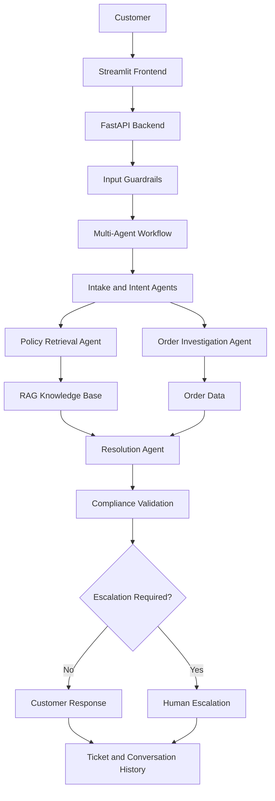

# 🚀 Autonomous Customer Support AI

### An Intelligent Multi-Agent Customer Support Automation Platform

<p align="center">
  
  
  
  
  
</p>

---

## 📌 Project Overview

**Autonomous Customer Support AI** is an AI-powered customer support automation platform designed to streamline customer service operations through multi-agent collaboration, Retrieval-Augmented Generation (RAG), policy validation, and workflow orchestration.

The platform uses specialized AI agents to understand customer requests, investigate order-related issues, retrieve relevant business policies, generate context-aware responses, validate compliance, and escalate complex cases for human intervention.

The project demonstrates how Agentic AI can be applied to real-world customer support operations.

## 🎯 Business Problem

Traditional customer support operations often face challenges such as:

- High volumes of repetitive customer queries.
- Manual order investigation and verification.
- Difficulty retrieving relevant business policies.
- Inconsistent customer responses.
- Delayed issue resolution.
- Limited visibility into support operations.

## 💡 Proposed Solution

This project introduces a multi-agent AI system that automates customer support workflows while maintaining policy awareness and human oversight.

The platform brings together:

- Specialized AI agents.
- RAG-based knowledge retrieval.
- Policy validation.
- Order investigation.
- Conversation context management.
- Automated response generation.
- Human escalation.

## 🏗️ System Architecture

The platform is organized into the following layers:

| Layer | Responsibility |
|---|---|
| Frontend Layer | Streamlit-based customer support interface |
| API Layer | FastAPI request handling and service communication |
| Guardrails Layer | Input validation, prompt injection checks, safety checks, and output validation |
| Multi-Agent Layer | LangGraph-based workflow orchestration |
| Knowledge Layer | Retrieval-Augmented Generation using business policy documents |
| Memory Layer | Conversation history and case context management |
| Evaluation Layer | Response quality evaluation, monitoring, and logging |
| Deployment Layer | Docker and Docker Compose |

### Architecture Diagram



*The diagram represents the intended logical workflow; individual connections should be aligned with the implemented backend.*

## 🤖 Multi-Agent Workflow

The system is organized around specialized agents with separate responsibilities.

| Agent | Responsibility |
|---|---|
| Intake Agent | Extracts customer information and order details |
| Intent Agent | Classifies customer intent and priority |
| Investigation Agent | Investigates order information |
| Policy Agent | Retrieves relevant business policies |
| Resolution Agent | Generates context-aware resolutions |
| Compliance Agent | Validates responses against policy evidence and verified information |
| Escalation Agent | Determines whether human intervention is required |

### Workflow Execution

1. Customer submits a support request.
2. The Intake Agent extracts relevant information.
3. The Intent Agent identifies the customer request.
4. The Investigation Agent retrieves order information.
5. The Policy Agent retrieves relevant business policies.
6. The Resolution Agent generates an appropriate response.
7. The Compliance Agent validates the response.
8. The Escalation Agent determines whether human assistance is required.
9. The system returns the response and maintains ticket information.

## 📚 Retrieval-Augmented Generation (RAG)

The RAG component supports knowledge-grounded customer support responses.

Key capabilities:

- Business policy document ingestion.
- Document processing and retrieval.
- Context-aware information retrieval.
- Policy-grounded response generation.
- Evidence-based response validation.

RAG helps connect generated responses with relevant business policy information.

## 🛡️ AI Guardrails and Security

The platform includes security and validation components designed to support controlled AI interactions.

- Input validation.
- Prompt injection pattern detection.
- Output validation.
- Sensitive information request checks.
- Basic safety checks.
- Policy compliance validation.
- API key authentication.
- Rate limiting.
- CORS configuration.

## 🧠 Conversation Memory

Conversation memory supports multi-turn customer interactions.

- Conversation history.
- Customer case context.
- Order ID continuity.
- Context-aware support interactions.

## 📊 Evaluation and Monitoring

The platform includes components for monitoring application activity and evaluating AI responses.

- Response quality evaluation.
- API performance monitoring.
- Request and error tracking.
- Agent execution monitoring.
- Audit logs.
- Evaluation history.

## 🛠️ Technology Stack

| Category | Technologies |
|---|---|
| Programming Language | Python |
| Frontend | Streamlit |
| Backend | FastAPI |
| Agent Orchestration | LangGraph |
| AI / LLM | Gemini |
| AI Architecture | Multi-Agent Systems |
| Knowledge Retrieval | RAG |
| Database | SQLite, SQLAlchemy |
| API Communication | REST API |
| Security | API Key Authentication, Rate Limiting, CORS |
| Testing | Pytest |
| Deployment | Docker, Docker Compose |

## 📁 Project Structure

```text
Autonomous_customer_support_AI/
│
├── backend/
│   ├── agents/
│   ├── api/
│   ├── core/
│   ├── database/
│   ├── graph/
│   ├── guardrails/
│   ├── mcp/
│   ├── models/
│   ├── rag/
│   ├── services/
│   ├── client.py
│   └── main.py
│
├── data/
│   ├── policies/
│   ├── orders/
│   └── vectorstore/
│
├── frontend/
│   ├── components/
│   ├── views/
│   └── styles.py
│
├── tests/
├── evaluation/
├── logs/
├── .streamlit/
│
├── .env.example
├── .gitignore
├── app.py
├── Dockerfile
├── docker-compose.yml
├── README.md
└── requirements.txt
```

*This is the documented project layout. Keep it synchronized with the actual repository structure.*

## ⚙️ Installation and Setup

### Prerequisites

- Python 3.11 or compatible environment.
- Git.
- Docker Desktop (optional, for containerized deployment).
- Gemini API Key.

### 1. Clone the Repository

```bash
git clone https://github.com/sabarinathan-raja/Autonomous_customer_support_AI.git
```

```bash
cd Autonomous_customer_support_AI
```

### 2. Create a Virtual Environment

```bash
python -m venv .venv
```

**Windows PowerShell:**

```powershell
.\.venv\Scripts\Activate.ps1
```

### 3. Install Dependencies

```bash
pip install -r requirements.txt
```

### 4. Configure Environment Variables

Create a `.env` file in the project root directory.

Add your configuration:

```env
GEMINI_API_KEY=your_gemini_api_key
GEMINI_MODEL=gemini-2.5-flash

DATABASE_URL=sqlite:///./customer_support.db

API_KEY=your_random_secure_api_key

API_HOST=127.0.0.1
API_PORT=8000
API_BASE_URL=http://127.0.0.1:8000

RATE_LIMIT_REQUESTS=60
RATE_LIMIT_WINDOW_SECONDS=60

CORS_ORIGINS=http://localhost:8501,http://127.0.0.1:8501
```

**Security Notice:** Never commit your actual `.env` file, API keys, passwords, or credentials to GitHub. Use `.env.example` with placeholder values only.

### 5. Start the Backend

```bash
uvicorn backend.main:app --reload
```

Backend URL:

```text
http://127.0.0.1:8000
```

API Documentation:

```text
http://127.0.0.1:8000/docs
```

### 6. Start the Frontend

Open another terminal and run:

```bash
streamlit run app.py
```

Frontend URL:

```text
http://localhost:8501
```

## 🐳 Docker Deployment

Build the Docker images:

```bash
docker compose build
```

Start the application:

```bash
docker compose up -d
```

Check running containers:

```bash
docker compose ps
```

View application logs:

```bash
docker compose logs -f
```

Stop the containers:

```bash
docker compose down
```

## 🧪 Testing

Run the guardrails test suite:

```bash
python -m pytest tests/test_guardrails.py -v
```

Run all project tests:

```bash
python -m pytest tests/ -v
```

## 💼 Business Applications

Potential business applications include:

- E-commerce customer support.
- Order and delivery management.
- Customer query automation.
- Policy-based support operations.
- Customer service management.

## 📈 Business Value

The project demonstrates how AI-driven automation can support customer service operations through:

- Reduced repetitive manual support activities.
- More consistent policy-aware responses.
- Structured order investigation.
- Context-aware customer interactions.
- Human intervention for complex cases.
- Improved operational monitoring and visibility.

## 🔮 Future Enhancements

- Advanced prompt injection detection.
- Dedicated PII detection and redaction.
- Stronger hallucination detection.
- Distributed rate limiting.
- Persistent security event auditing.
- Advanced agent observability.
- Cloud deployment and scalability improvements.
- CRM and enterprise ticketing platform integration.

## 👨‍💻 Project Focus

This project focuses on applying:

- Generative AI.
- Agentic AI.
- Retrieval-Augmented Generation.
- Multi-Agent Systems.
- Backend Engineering.
- Workflow Orchestration.
- Application Security.
- Containerization.

> Building intelligent AI systems that go beyond answering questions — systems designed to understand, investigate, validate, and resolve customer support requests.

---

⭐ If you find this project interesting, feel free to explore the repository and share your feedback.

### Tags

`#AgenticAI` `#GenerativeAI` `#MultiAgentSystems` `#RAG` `#LangGraph` `#FastAPI` `#Python` `#EnterpriseAI` `#Docker` `#CustomerSupportAutomation`
